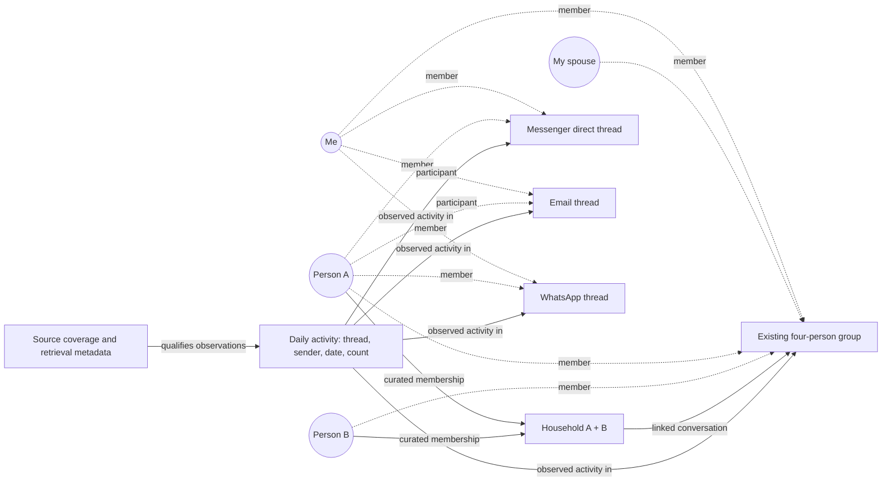

# Relationship and contacts store

Product specification · Draft v0.4

## 1. Purpose

Create a household-centered relationship store that builds on existing Google contacts, email, Facebook Messenger, and text-message conversations, adding the context needed to care for people intentionally.

The first development milestone is a model and visualization of whom the user interacts with and how often. The longer-term primary experience is a weekly recommendation of households to reconnect with, recognizing that different relationships need different rhythms. Identifying whom to share an important life update with remains an immediate use case.

The store also supports prayer planning, remembering conversations, following through on commitments, and eventually communicating with supporters before and during an overseas move.

This is a relationship companion, not a donation-management system or an autonomous messaging system.

## 2. Confirmed product decisions

- Households are the primary relationship unit.
- The contact set includes personal, church/community, and professional relationships.
- Existing sources are Google contacts and email.
- Desired additional connectors are Facebook Messenger and text messaging.
- The communication model must unify data across Google contacts, email, text messages, Messenger, and WhatsApp, rather than remain a view of one service.
- Existing one-to-one and group conversations must be linkable to people, households, and groups. A key example is a group text between the user, the user's wife, and another couple.
- Records will be populated gradually with the assistant, rather than requiring a comprehensive initial import.
- Reconnection rhythms are individually curated, not imposed by universal relationship tiers.
- The user explicitly records meaningful connections, including encounters in recurring groups.
- Typed notes are the initial capture method. Dictation can be supported later.
- Notes are saved as given; capturing a note does not require approving a rewritten or structured version.
- The assistant helps triage prayer requests, follow-ups, and priorities.
- Suggested email-recipient lists may be assembled automatically, but sending is manual.
- Update wording may differ for Christian and non-Christian audiences.
- Donation records remain in a separate system.
- Detailed privacy and access-control design is deferred.

The mechanics described below are proposed implementation requirements, not additional decisions already made by the user.

## 3. Core record model

| Record | Purpose and proposed information |
| --- | --- |
| Household | Display name, members, relationship context, associated communities/groups, selected reconnection rhythm, and explicitly recorded communication preferences. |
| Person | Individual name, email addresses, phone numbers, provider-specific identities, and links to source contacts. Each person belongs to a household; a household may contain one person. |
| Group | A user-defined community or recurring social group, with associated people and households. A group is distinct from a messaging thread. |
| Conversation thread | Provider, source account, stable source thread identifier where available, title, participants, links to associated people/households/groups, source-opening link where supported, and available activity metadata. |
| Note | Original user text, capture time, associated household or households, and optional conversation/event date. Preserve the original even when producing summaries. |
| Connection | Household, date, people involved when known, interaction type/context, and related notes. User-recorded connections determine the confirmed last meaningful connection. |
| Prayer request | Request/context, associated household and optional person, recorded date, updates, and user-confirmed status. |
| Follow-up | Intended action, associated household, source note or conversation, optional due date, and completion/deferment state. |
| Update audience | Update purpose, candidate households and individual recipients, reasons for inclusion, wording preferences, and the reviewed recipient selection. |

Household organization must not erase person-specific context. A prayer request may concern one member, and an email may go to one or multiple members.

Thread associations are many-to-many: a household may have several threads across channels, and a thread may involve several households. A couple's group text is associated with that couple's household while retaining all four participants, including the user and the user's wife. It must not create a new household containing everyone in the chat.

Assistant-derived information must be distinguishable from explicit user statements and traceable to its source.

## 4. Initial population

For curated household population, start by developing the recipient list for the user's current life update. The communication-map milestone can ingest uncurated source identities before household review; an observed correspondent is not automatically a curated important contact.

1. The user identifies households they already know they want to include.
2. The assistant helps find corresponding Google contact information, relevant email history, and existing messaging threads where connector access is available.
3. The user and assistant resolve household membership, duplicate contacts, and uncertain matches.
4. Link existing conversations to the appropriate people, households, or groups; add relationship context and reconnection preferences as they become useful.
5. Expand the store over time through new notes, outreach planning, and weekly reviews.

Do not automatically treat every email correspondent or chat participant as an important relationship. Do not silently merge ambiguous people or households. Integration method and initial import volume remain implementation choices.

## 5. Note capture and relationship history

The user can type a note in natural language and associate it with a household. One note may describe an encounter involving several households.

The original note is saved immediately and remains retrievable. The assistant may identify potential prayer requests, follow-ups, or connections from it, but must not replace the note with its interpretation.

Explicit statements can update the corresponding records. Ambiguous implications remain suggestions; the assistant may ask a brief clarifying question when needed.

Capture time and interaction time are separate. If the user describes an earlier conversation, do not label it as occurring on the day the note was entered.

The user decides what counts as meaningful connection. Email activity, messaging activity, or group attendance must not silently reset a household's reconnection clock. Display observed channel activity separately from confirmed meaningful connections.

## 6. Weekly reconnection review

Produce a short, prioritized list of households worth reaching out to.

For each recommendation, show:

- Why the household surfaced now.
- The last confirmed meaningful connection, or that it is unknown.
- Relevant recent conversation context.
- Active prayer requests and outstanding follow-ups.
- A suggested next action.
- Linked conversations that provide a practical place to reconnect, with source-opening links where supported.

Candidate signals include the household's chosen reconnection rhythm, explicit follow-up commitments, relevant upcoming events, active concerns, and a life update the user wants to share.

Recommendations must explain their evidence. Missing history is not proof that a relationship has been neglected. Avoid guilt-oriented scoring and rankings that imply a household's worth.

The user should be able to record a connection, complete a follow-up, or defer a recommendation. Deferring outreach must not automatically change the household's long-term rhythm.

List size, prioritization rules, snooze behavior, and whether reviews are requested or scheduled remain open design choices. Five households may be an initial tuning option, not a fixed requirement.

## 7. Prayer planning and triage

The assistant helps turn recorded requests into a manageable prayer plan and keep the underlying information useful.

It may:

- Group related requests and suggest priorities.
- Surface time-sensitive requests when timing is explicitly known.
- Bring older requests back for review.
- Suggest a plan based on the recorded context.
- Ask whether a request has changed or been answered.

The assistant must not infer that a request is answered, resolved, or no longer relevant simply because time passed. Status changes require an explicit user statement or confirmation.

Prayer-plan cadence and organization are not yet fixed. Plans should remain editable and grounded in stored requests rather than invented personal circumstances.

## 8. Life updates and email audiences

Given the purpose of an update, help enumerate an appropriate recipient list from the curated store and recorded relationship context.

Each suggested inclusion should have a reason, such as an explicit desire to keep the household updated or a previous conversation about the topic.

Resolve household selections to actual individual email recipients, expose missing or ambiguous addresses, and prevent duplicate recipients.

Support explicitly recorded wording preferences, including Christian and non-Christian versions when appropriate. Do not infer someone's beliefs from their name, group membership, or email history.

Present the candidate list for review and allow additions and exclusions before producing a final recipient list. Drafting wording can be supported, but is secondary to selecting the right audience.

All sending is manual. The system must not send, schedule, or enroll recipients in campaigns on the user's behalf.

## 9. Future support-raising use

Reuse the relationship history and audience workflows for:

- Preparing supporter updates.
- Identifying households for individual reach-outs.
- Remembering support-related conversations.
- Tracking explicit follow-up commitments and ongoing communication.

Do not automatically classify every relationship as a fundraising prospect. Financial contribution records, payment processing, donation reconciliation, and tax receipts are outside scope.

Any future connection to a donation system should be separately specified.

## 10. Source integration and reliability

### Connector goals

Google contacts provide identity and address information. Email, Facebook Messenger, and text-message connectors provide conversation discovery, thread associations, and optional relationship evidence as access permits.

The product must distinguish three capabilities rather than treating a connector as simply connected or disconnected:

- Linking an existing conversation to a record.
- Reading participants and activity metadata.
- Reading message history for context.

Linking a conversation remains useful even when automated history access is unavailable.

### Linking existing conversations

Allow the user to find or manually identify an existing thread and associate it with people, households, or groups. Provider identities and known email addresses or phone numbers may suggest matches; ambiguous matches require review, and names alone must not trigger silent identity merges.

A household page should show its linked conversations across channels. Allow an explicitly selected preferred thread for outreach, including an existing couple-to-couple group text.

Preserve thread identity independently of its title or changing participant list. Multiple threads with the same people remain separate unless the user deliberately changes their associations.

Where supported, open the original conversation in its source app. If no usable opening link is available, show the channel, thread title, and participants without inventing a link.

### Access and synchronization

Actual Facebook Messenger and text-message access mechanisms must be investigated before committing to live synchronization or full-history import. The user's messaging platform/device, account scope, available provider APIs, and export capabilities have not been selected or verified.

Use supported, authorized access mechanisms. Where live access is unavailable, support manual thread references and investigate user-provided exports as a separately disclosed alternative. Do not present manual links or imported snapshots as live synchronization.

When history or metadata is ingested, retain source identifiers, original event timestamps, and synchronization/import status. Repeated imports must not duplicate the same source messages or threads. Clearly indicate incomplete history, stale data, and unavailable capabilities.

Linked chat membership is not permission to read another participant's account or imply that the user's wife has shared her account.

Maintain source links where available. Imported information and assistant suggestions must not overwrite user-curated context silently.

For the first version, treat the relationship store as an overlay: no Google-contact edits, message sending, group creation, participant changes, or destructive source changes. Outreach uses the existing channel manually.

Display source-access failures and uncertain matches explicitly. The user must still be able to enter notes and view saved records when a source integration is unavailable.

## 11. Privacy boundary

Detailed privacy design is deferred, not waived. Do not assume shared access, spouse access, team access, or unrestricted use of sensitive notes in AI processing or drafts.

Before deployment with real private notes, explicitly decide access scope, storage and processing boundaries, retention/deletion, and which information may appear in outreach outputs.

## 12. First-version scope and acceptance criteria

### First milestone: observed communication map

Before building reminder and prayer workflows, develop an evidence-based, cross-source view of people, conversation threads, and interaction frequency. The goal is to bring all available, user-authorized communication data from email, text messages, Messenger, WhatsApp, and future sources into one model, not create separate channel-specific contact graphs.

Acquire available history and support ongoing updates where each source permits. Report unavailable history and unsupported capabilities explicitly; "all sources" is the product goal, not a guarantee of unrestricted access to every historical message. A first connector can bootstrap development, but the model and visualization must support multiple sources from the outset.

Use people and conversation threads as separate graph node types. A person's membership in a group is different from their observed participation. Do not expand one group message into claimed direct interactions with every member, or infer relationships between other people merely because they share a chat.

Households remain the curated relationship unit, with optional household rollups once membership is confirmed. Do not infer couples or household membership from surnames or chat membership.

Initial views:

- A primary hub-and-spoke view centered on the user, showing people with more frequent observed interaction nearer the center and less frequent interaction farther away.
- A supporting person-to-thread view distinguishing group membership from actual participation.
- A ranked frequency view separating direct conversations from group activity.
- A weekly timeline showing changes within available history.

The primary output is a summary and visualization of interactions with people over the last 7 days, last 30 days, or a selected custom period, combining all available sources. Show distinct people with observed direct activity, group-only participants separately, sent/received activity by channel, active days, and latest observed interaction. Include a people table, user-centered relationship graph, supporting person-to-thread graph, and daily activity timeline; each must use the same filtered dataset and expose source coverage.

Make period semantics explicit. As an initial convention, "last N days" means the current local calendar day plus the preceding N-1 days, ending at the displayed as-of instant, with the current day labeled partial. Resolve boundaries in the selected time zone and use a start-inclusive, end-exclusive interval. Preserve event timestamps so custom ranges and daylight-saving transitions are handled correctly. Display the actual date range, time zone, as-of time, and source freshness. This convention is a proposed default, not a previously confirmed user preference.

Measure observed sent/received message counts, distinct active days, days when both sides posted, and latest observed activity. In a group, days when the user and another person both posted indicate shared participation, not necessarily a direct exchange. Message volume is not a relationship-importance score or a confirmed meaningful connection.

Track the requested period, time zone, retrieval time, source, and history coverage per thread. Unavailable counts remain unknown rather than zero. Present partial counts as observed lower bounds, and do not compare unobserved weeks as if they were inactive.

Build and display the communication map in the contacts product, not inside Muse. Email, text messages, Messenger, and WhatsApp are in scope; Google contacts provide identity information. Muse is a possible acquisition bridge for supported sources, not the destination for the visualization or the owner of the relationship model. Final connector selection remains open. Any assistant-provided narrative is not independently verified source data; require structured aggregates and reconcile totals before using numerical results in visualizations.

#### Unified ingestion and identity

Each adapter produces source accounts, source identities, conversation threads, participant memberships, and timestamped communication observations using a shared schema. Keep provider IDs namespaced by source and account. Preserve provenance so the combined view can always be separated back into its original sources.

Map several source identities to one canonical person, and people to curated households. Email addresses, phone numbers, and reviewed provider profiles provide matching evidence. Never merge people solely by display name. Allow incorrect matches to be split without losing source observations or user notes.

Retain email threads, SMS/MMS/RCS conversations, Messenger threads, and WhatsApp groups as distinct conversations even when the people overlap. Deduplicate repeated ingestion of the same source event; do not deduplicate separate messages across channels merely because their text matches. When two connectors expose the same underlying source, reconcile source identity before combining counts.

Record sender and recipient roles, including email To/CC roles when available. A broadcast email or a busy group must not count as a separate direct exchange with every recipient/member. Google contact presence alone creates no interaction.

Present combined activity alongside a per-channel breakdown. Distinct active days across channels are a union of dates in the selected time zone, not the sum of each channel's active-day counts. Preserve channel-specific message volumes rather than implying one email is equivalent in significance to one short text.

#### A set of composable aggregation skills

Implement the eventual data-aggregation workflow as a set of focused, reusable skills, not one Muse prompt or a single monolithic skill. Skills coordinate authorized tools/adapters and shared deterministic processing; a skill does not itself create endpoint access or bypass provider restrictions. Follow Churchtree's existing skill conventions when implementing them. The names below describe responsibilities rather than prescribe file paths or framework choices.

| Skill responsibility | Inputs and output |
| --- | --- |
| Contact identity collection | Read authorized Google contact records and return source identities, addresses, phone numbers, and matching evidence. This supplies identity evidence, not communication activity. |
| Email activity collection | Retrieve available email conversations and timestamped message metadata, including sender and recipient roles, pagination and coverage. Exclude bulk/automated mail from interpersonal summaries using explicit, inspectable classifications; retain counts of excluded or unclassified records. |
| Text-message activity collection | Read authorized SMS/MMS/RCS or iMessage sources/exports as supported, retaining group participants, source timestamps, and import/device coverage. Report unsupported formats or unavailable history. |
| Messenger activity collection | Retrieve available personal Messenger activity through a verified authorized adapter, preserving thread identities, actual senders, and coverage. Do not assume a business/Page API reads personal conversations. |
| WhatsApp activity collection | Retrieve available personal WhatsApp activity through a verified authorized adapter, preserving existing group threads and linked-device/history limits. Do not assume a business API provides personal-inbox access. |
| Identity reconciliation | Propose links from source identities to canonical people, reuse confirmed mappings, and return unresolved candidates for review. Do not merge on names alone or infer households. |
| Cross-source interaction aggregation | Normalize observations, deduplicate repeated ingestion, apply confirmed identity mappings and period/channel filters, and produce reproducible per-person, per-thread, per-channel, and daily aggregates. Keep group participation separate from direct activity. |
| Interaction summary and visualization | Consume the shared aggregates and coverage report to produce the 7-day, 30-day, or custom-period summary, people table, graph, and timeline without inventing counts or relationship-quality scores. |

A coordinating skill may run the requested collectors and then reconciliation, aggregation, and presentation. Each constituent skill must also be usable independently, for example to refresh email without rereading every source, or regenerate a 30-day visualization from already collected observations.

Collection inputs include authorized account references, requested time interval/time zone, and an optional source checkpoint. Outputs include schema version, source/account identity, retrieval time, source records or observations, pagination/completion state, next checkpoint where supported, coverage boundaries/uncertainty, and explicit errors. References to credentials may be passed through the approved tooling; credentials and private message data must never be embedded in skill files or committed examples.

Treat history access and completion separately: an exhausted local page cursor does not prove complete upstream history. Advance an incremental checkpoint only for successfully persisted observations. A failed source must remain visibly unavailable/partial while successful sources can still produce a clearly labeled partial report. Require idempotent imports and resumable pagination where supported; never silently convert authentication failures or missing history into empty activity.

Retain timestamped metadata sufficient to recalculate periods; daily counts alone cannot resolve arbitrary intraday boundaries. Separate message events from reactions, membership/system events, and edits/deletions, reporting unsupported reconciliation explicitly. Message bodies are not required for the initial frequency views; collect additional content only under a separately authorized context workflow.

The aggregation output contract includes the resolved interval/time zone/as-of instant, applied filters and identity-mapping revision, per-source freshness and coverage, unresolved identities, deduplication/exclusion counts, and the aggregates consumed by every view. Unknown values remain null/unknown, and source-limited totals are labeled observed lower bounds.

Keep the checked-in deliverable a specification: this document does not claim the skills or endpoint access already exist, and checking it in does not authorize connecting accounts, collecting private data, or scheduling collection.

#### Graph model

The following diagram illustrates the model, not actual contacts or measured activity:

In the interactive graph, use distinct shapes for people, households, and threads. Membership edges remain visually distinct from activity edges. Activity-edge thickness may encode observed active days within the selected period, with exact message counts and latest activity available on selection. Show a legend and never assign numerical weights where counts are unknown.

Support a date-range selector and filters for channel, direct versus group conversations, and outgoing versus incoming-only activity. Selecting a person, household, or thread reveals its supporting activity and source coverage. Household rollups deduplicate the same underlying message/activity record rather than counting it once per household member.

#### Primary visualization: user-centered relationship map

Place the user at the center, with people as surrounding nodes and spokes representing observed communication with the user. Encode interaction frequency using intentional radial positioning: people with more frequent observed direct activity appear closer to the center, and less frequent activity farther away. This is communication proximity, not a judgment of affection, importance, or relationship quality. Use labeled frequency bands and an inspectable metric rather than incidental force-directed layout distance.

As an initial proposed metric, use distinct days with observed direct communication in the selected period, with sent/received breakdowns, message counts, and latest activity shown on selection. Show time since latest observed direct activity with a labeled visual treatment such as color or an age badge. Keep unknown coverage distinct from an observed lack of activity.

Group-only participants must remain visible as a separately labeled category or through the supporting thread view. Do not give them a direct-interaction spoke or move them inward merely because other members posted in a shared group. Shared group participation can be displayed as a separate layer, with an explicit legend; it is not evidence that the user addressed each participant.

Keep previously observed or curated people available even when they have no observed activity in the selected window, rather than filtering away precisely the people who may warrant reconnection. Show them in an outer "no observed activity in this period" band, distinguishing complete observed silence from incomplete/unknown source history.

Highlight potential reconnection opportunities and activity outliers: people whose recent interaction has fallen below their own historical pattern, or whose user-selected reconnection rhythm is due. These are separate signals from simple low frequency. Show the prior baseline, current activity, last observed contact, coverage, and reason for each highlight. Do not invent a baseline when history is insufficient or compare mismatched source coverage as if it were a decline. Thresholds remain an implementation/tuning decision, not a universal relationship score.

Selecting a person opens the supporting channel/thread activity and any separately recorded meaningful connections or reconnection preferences. Do not automatically reset a meaningful-connection date or send outreach from this view.

The supporting person-to-thread graph answers who participates where; the primary map, ranked view, and timeline answer how often and where recent changes may merit attention. The diagram above illustrates the underlying data model, not the final hub-and-spoke screen layout.

Milestone acceptance criteria:

1. Link the same person to email addresses, phone numbers/text identities, and Messenger/WhatsApp identities through reviewed mappings; show combined and per-source activity.
2. Display an existing couple-to-couple group with all four people and the other couple's household association, without inventing pairwise interactions.
3. Show direct-message frequency separately from participation in shared groups.
4. Change the date range and channel filters without treating missing history as zero activity.
5. Trace every displayed count to structured source observations and show incomplete coverage.
6. Render the visualization in the contacts product independently of Muse.
7. Ingest email, text-message, Messenger, and WhatsApp observations through the shared schema; expose unsupported source access rather than claiming completion.
8. Re-ingest data without duplicate counts, and calculate cross-channel active days without counting the same date multiple times.
9. Produce consistent 7-day, 30-day, and custom-period summaries, people tables, graphs, and timelines from the same aggregates, with explicit interval semantics.
10. Define independently usable source-collection, identity-reconciliation, aggregation, and presentation skills with shared contracts; demonstrate the eventual implementation using synthetic fixtures rather than committing private messages.
11. Preserve visible partial-source failures and unresolved identities in the final summary; neither may be silently dropped into a success-shaped empty report.
12. Render the user at the center of the primary map, with explainable frequency-based radial positioning, visible recency, and distinct treatment for group-only activity and unknown coverage.
13. Retain known people with no observed activity in the selected period and highlight explainable reconnection opportunities or changes from a person's own baseline without equating low message volume with relationship neglect.

Keep stable provider identifiers where available. Application-generated IDs must be labeled as local identities; if the source exposes only names, require explicit reconciliation rather than silently merging identities.

No automatic sending, connector setup, or recurring data collection is implied by this milestone.

### Broader first-version acceptance criteria

The first version is successful when:

1. The current life-update audience can seed a curated set of household records with individual contact addresses.
2. Typed notes are stored unchanged and can be retrieved with their associated households.
3. Meaningful connections can be recorded explicitly without email or messaging activity automatically changing their dates.
4. Different households can have different user-selected reconnection rhythms.
5. A weekly review produces explainable outreach recommendations with relevant context and follow-ups.
6. The assistant can assemble a prayer plan from recorded requests and surface requests needing review without inventing status changes.
7. An update can produce an editable recipient list with inclusion reasons and no duplicate email recipients.
8. User-curated information remains distinct from imported evidence and assistant suggestions.
9. No messages are sent automatically, and no donation records are managed.
10. An existing four-person couple-to-couple group text can be associated with the other couple's household while preserving all participants and without combining them into one household.
11. Multiple conversations across email, Messenger, and text can be linked to a household; conversations involving multiple households can also be associated with the appropriate group.
12. Connector capabilities and limitations are visible. A manually linked thread works without history access, and imported history is not represented as live synchronization.

The first version requires the conversation-linking model and workflow. Live Messenger/text synchronization is a desired connector outcome, not a verified first-release capability.

The specification does not yet select a technology stack, interface, hosting model, messaging device/platform, connector access mechanism, or automation schedule. Those choices should follow the relationship workflows above rather than drive them.
